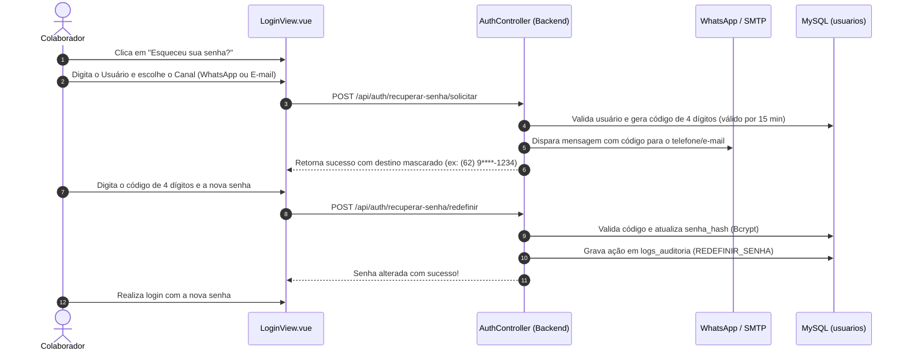

# Documentação Técnica e Operacional: Módulo Autenticação & Recuperação de Senha (`LoginView.vue`)

> **Documento de Arquitetura, Regras de Negócio e Manual Operacional**  
> **Status:** Atualizado com autenticação JWT, proteção de força bruta, recuperação em duas etapas via WhatsApp (Evolution API) e E-mail (SMTP), com código temporário de 4 dígitos.

---

## 1. Visão Geral e Propósito

O módulo de **Autenticação & Recuperação de Senha** gerencia o controle de acesso de todos os colaboradores ao **Guicell Manager**.

Seus principais objetivos são:
- Garantir a autenticidade dos operadores através de credenciais seguras.
- Emitir tokens **JWT (JSON Web Token)** criptografados com tempo de expiração para sustentar uma arquitetura de API *stateless*.
- Barrar o acesso de usuários inativados ou com credenciais incorretas.
- Fornecer um mecanismo moderno e autônomo de **recuperação de senha** através de código numérico temporário (OTP - One-Time Password) de 4 dígitos.
- Integrar a recuperação aos dois canais oficiais mais utilizados no dia a dia da loja: **WhatsApp** (disparo automático via Evolution API) e **E-mail** (Nodemailer/SMTP).
- Rastrear a redefinição de senhas na tabela `logs_auditoria` para segurança contra acessos indevidos.

---

## 2. Interface do Usuário (`LoginView.vue`)

A tela de login é composta por dois painéis com identidade visual customizada:

### 2.1. Painel de Apresentação (Hero Panel)
- Logotipo oficial da **Guicell Assistência Técnica**.
- Vitrine institucional destacando os 4 pilares do sistema: Ordens de Serviço, Controle de Caixa, Ponto de Venda e Gestão de Estoque.

### 2.2. Formulário de Acesso
- **Campo Usuário:** Login cadastrado pelo administrador (case-insensitive).
- **Campo Senha:** Entrada segura com botão alternador de visibilidade (ícone de olho).
- **Alertas de Erro:** Mensagens claras em caso de credenciais inválidas, usuário desativado ou falha de conexão.
- **Link "Esqueceu sua senha?":** Dispara o fluxo de auto-atendimento de recuperação.

---

## 3. Fluxo de Recuperação de Senha em 3 Etapas



### 3.1. Etapa 1: Solicitação do Código
- O colaborador informa seu login e seleciona o canal de envio:
  - **WhatsApp:** O sistema localiza o telefone cadastrado do colaborador e dispara o código via Evolution API.
  - **E-mail:** O sistema localiza o e-mail cadastrado e dispara a mensagem com o código via SMTP.
- O sistema apresenta o destino mascarado (ex: `(62) 9****-8630` ou `e****e@gmail.com`) para conferência sem expor dados sensíveis na tela.

### 3.2. Etapa 2: Inserção do Código OTP
- Interface moderna com 4 caixas numéricas individuais.
- Ao digitar um dígito, o foco avança automaticamente para a próxima caixa.
- Possui suporte a colar o código completo (*paste*) e temporizador de reenvio de 60 segundos para evitar disparos em massa.

### 3.3. Etapa 3: Definição da Nova Senha
- Campos para Nova Senha e Confirmação de Senha.
- Validação mínima de segurança (mínimo de 6 caracteres).
- Ao confirmar, o backend invalida o código temporário, gera o novo hash Bcrypt e grava um registro na tabela `logs_auditoria` (`acao: 'REDEFINIR_SENHA'`).

---

## 4. Arquitetura do Backend e Segurança

### 4.1. Tokens JWT
- No login bem-sucedido, o backend gera um token assinado com `JWT_SECRET`:
  ```json
  {
    "id_usuario": 1,
    "login": "gerente",
    "perfil": "Gerente",
    "permissoes": { ... }
  }
  ```
- O token é armazenado no `localStorage` do navegador e injetado automaticamente em todas as requisições HTTP pelo interceptor Axios (`Authorization: Bearer <token>`).

### 4.2. Criptografia de Senhas
- As senhas são protegidas com `bcryptjs` usando fator de custo (*salt rounds*) 10.
- Impossibilita a descriptografia mesmo em caso de vazamento da base de dados.

### 4.3. Expiração de Sessão
- Tokens possuem tempo de vida configurável (`JWT_EXPIRES_IN`, padrão 8 horas).
- Se o token expirar ou for invalidado (HTTP 401), o interceptor Axios direciona o usuário imediatamente para a tela de login.

---

## 5. Endpoints do Módulo

- **`POST /api/auth/login`** — Validação de credenciais e emissão do token JWT.
- **`GET /api/auth/me`** — Retorno dos dados do usuário autenticado e suas permissões ativas.
- **`POST /api/auth/recuperar-senha/solicitar`** — Geração e envio do código de 4 dígitos via WhatsApp ou E-mail.
- **`POST /api/auth/recuperar-senha/redefinir`** — Validação do código OTP e gravação da nova senha auditada.

