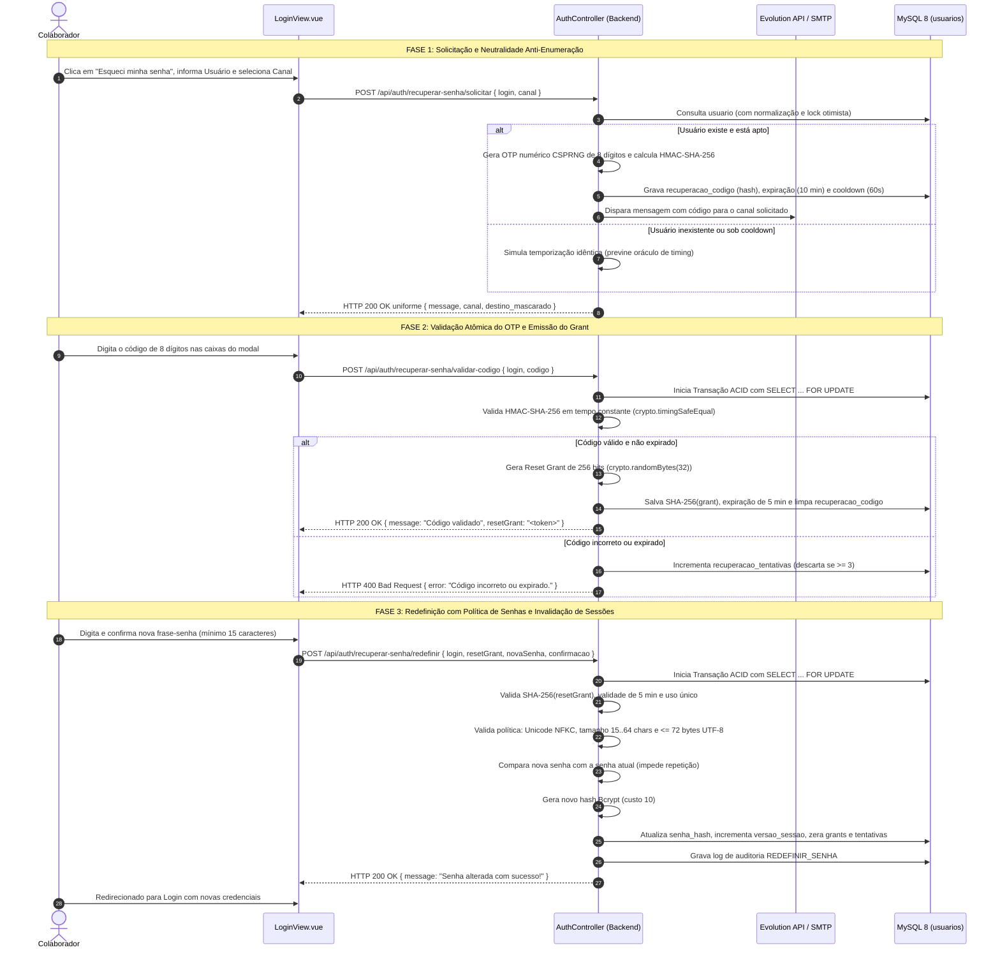

# Documentação Técnica e Operacional: Módulo de Autenticação & Recuperação de Senha (`LoginView.vue`)

> **Documento de Arquitetura, Regras de Negócio e Manual Operacional — TCC II (UNIALFA 2026)**  
> **Status:** Atualizado com arquitetura de segurança reforçada (*Hardened Auth*), em conformidade com **NIST SP 800-63B** e **OWASP ASVS v4.0**: desafio OTP numérico de 8 dígitos (CSPRNG), autorização em duas fases via *Reset Grant* de 256 bits, versionamento de credenciais (`versao_sessao`), mitigação de oráculos de enumeração, prevenção de concorrência por bloqueio pessimista (`SELECT ... FOR UPDATE`) e tratamento do limite físico de 72 bytes do Bcrypt com normalização Unicode NFKC.

---

## 1. Visão Geral e Propósito

O módulo de **Autenticação & Recuperação de Senha** gerencia o ciclo completo de identificação, emissão de credenciais, controle de acesso e recuperação de contas de todos os operadores do **Guicell Manager**.

Seus objetivos centrais são:
- **Autenticidade e Controle de Acesso:** Garantir a autenticidade dos operadores através de credenciais criptografadas e validação rigorosa de status da conta (`ativo = true` e ausência de bloqueio temporal por tentativas incorretas).
- **Emissão e Revogação Imediata de Sessões (JWT):** Emitir tokens *JSON Web Token* assinados assimetricamente (`HMAC-SHA256`) contendo a versão da sessão (`versao_sessao`). Qualquer alteração de senha ou bloqueio administrativo invalida instantaneamente todos os tokens ativos do usuário sem dependência de estado em memória.
- **Recuperação de Senha Segura e Desacoplada (3 Etapas):** Substituir códigos estáticos e previsíveis por um desafio numérico de 8 dígitos gerado por fonte criptográfica segura (`crypto.randomInt`), com armazenamento exclusivo sob hash HMAC/SHA-256 e validação atômica via token *Reset Grant* de 256 bits de uso estritamente único.
- **Multicanal Oficial de Comunicação:** Entrega automatizada do código temporário via **WhatsApp** (Evolution API) ou **E-mail** corporativo (Nodemailer/SMTP), com mascaramento de destino.
- **Resistência contra Ataques Automatizados:** Aplicação de *rate limiting* multicamada (por IP e por conta), bloqueio progressivo contra força bruta (5 falhas consecutivas de login = bloqueio temporário de 15 minutos; 3 falhas de OTP = descarte do código) e neutralidade estrita de resposta contra ataques de enumeração de usuários.
- **Rastreabilidade e Não-Repúdio:** Registro detalhado de cada etapa crítica de acesso e recuperação na tabela `logs_auditoria` (`LOGIN_SUCESSO`, `LOGIN_FALHA`, `SOLICITAR_RECUPERACAO`, `VALIDAR_OTP_RECUPERACAO`, `REDEFINIR_SENHA`).

---

## 2. Interface do Usuário (`LoginView.vue`)

A tela de login e recuperação de senha é dividida estruturalmente em dois painéis responsivos:

### 2.1. Painel Institucional (Hero Panel)
- Logotipo oficial e identidade visual da **Guicell Assistência Técnica**.
- Vitrine institucional apresentando os 4 eixos operacionais do ERP: Ordens de Serviço, Controle de Caixa / Fluxo Financeiro, Ponto de Venda (PDV) e Gestão de Estoque.

### 2.2. Formulário de Acesso
- **Campo Usuário:** Identificador textual cadastrado (case-insensitive com *trimming* sanitizado).
- **Campo Senha:** Entrada oculta com botão alternador de visibilidade (ícone de olho) e amortecimento de temporização contra oráculos de tempo.
- **Controle "Lembrar de mim":** Persistência segura do login no armazenamento local (`localStorage`), sem jamais reter senhas ou segredos no dispositivo do operador.
- **Link "Esqueci minha senha":** Abre o modal dinâmico de autoatendimento em 3 etapas progressivas.

### 2.3. Modal Responsivo de Recuperação de Senha
- **Passo 1 (Canal e Destino):** Seleção do método preferencial para recebimento do código (WhatsApp ou E-mail), exibindo o destino com mascaramento preventivo de privacidade (ex.: `(62) 9****-8630` ou `e****e@gmail.com`).
- **Passo 2 (Inserção do Desafio de 8 Dígitos):** 
  - Interface com **8 caixas numéricas individuais** (`.code-digit-box`), com foco sequencial automático ao digitar e suporte a retrocesso (*Backspace* e setas direcionais).
  - Suporte completo à colagem (*Paste*) de códigos de 8 dígitos em qualquer uma das caixas.
  - Layout totalmente responsivo via regras de `@media (max-width: 440px)` para garantir que as 8 caixas mantenham-se dispostas horizontalmente e perfeitamente legíveis em smartphones.
  - Temporizador progressivo de *cooldown* de 60 segundos para controle de reenvio.
- **Passo 3 (Definição da Nova Senha):**
  - Entradas para Nova Senha e Confirmação de Senha com validação em tempo real.
  - Exigência estrita de política de frase-senha: mínimo de 15 caracteres e máximo de 64 caracteres.

---

## 3. Fluxo de Recuperação de Senha em 3 Etapas Seguras

O fluxo elimina o acoplamento do envio do OTP com a alteração final de senha, introduzindo uma barreira criptográfica intermediária (*Reset Grant*):



---

## 4. Arquitetura do Backend e Controles Criptográficos

### 4.1. Tokens JWT e Versionamento de Sessão (`versao_sessao`)
- No login autenticado com sucesso, o backend emite um token JWT contendo as credenciais de sessão e a versão da conta:
  ```json
  {
    "id_usuario": 1,
    "login": "gerente",
    "perfil": "Gerente",
    "versao_sessao": 3,
    "iat": 1794100000,
    "exp": 1794128800
  }
  ```
- O middleware [`auth.middleware.js`](file:///c:/trabalho/clientes/guicell/guicell-manager/backend/src/middlewares/auth.middleware.js) intercepta todas as rotas protegidas e compara o valor `payload.versao_sessao` com o campo `versao_sessao` persistido na tabela `usuarios`.
- Ao redefinir a senha ou revogar acessos, o backend incrementa atomicamente `versao_sessao = versao_sessao + 1`. Qualquer JWT gerado anteriormente passa a ser **rejeitado imediatamente com HTTP 401 Unauthorized**, forçando o encerramento de todas as sessões ativas do operador em outros navegadores ou aparelhos.

### 4.2. Criptografia de Senhas, Normalização NFKC e Limite do Bcrypt (72 Bytes)
- **Normalização Canônica:** Todas as senhas passam por `password.normalize('NFKC')` para padronizar caracteres acentuados, símbolos e sequências tipográficas.
- **Proteção contra Truncamento Silencioso do Bcrypt:** O algoritmo Bcrypt ignora fisicamente qualquer byte além do 72º byte UTF-8. Senhas longas ou contendo caracteres multibyte (emojis ou caracteres acentuados que consomem de 2 a 4 bytes) poderiam sofrer colisão ou perda de entropia. O serviço [`passwordPolicy.service.js`](file:///c:/trabalho/clientes/guicell/guicell-manager/backend/src/services/passwordPolicy.service.js) impõe:
  - Tamanho mínimo de **15 caracteres** (foco em frases-senha de alta memorização e entropia).
  - Tamanho máximo de **64 caracteres**.
  - Validação estrita: `Buffer.byteLength(normalizedPassword, 'utf8') <= 72`.
- **Amortecimento no Login:** Se um usuário submeter no login uma senha que exceda 72 bytes, a rota executa um hash simulado via `bcrypt.compare` para uniformizar o tempo de resposta e evitar oráculos de temporização.

### 4.3. Geração e Armazenamento do OTP (CSPRNG + HMAC-SHA-256)
- Os códigos temporários de 8 dígitos são gerados por gerador pseudoaleatório criptograficamente seguro:
  ```javascript
  const codigo = crypto.randomInt(10000000, 100000000).toString();
  ```
- O código em texto claro **nunca é persistido no banco de dados**. O sistema armazena unicamente o hash HMAC-SHA-256 (`recuperacao_codigo`) gerado com uma chave de alta entropia (`RESET_OTP_HMAC_KEY`).
- A comparação de verificação é realizada utilizando `crypto.timingSafeEqual` para blindar o sistema contra ataques de canal lateral baseados em tempo (*timing attacks*).

### 4.4. Token Reset Grant de Uso Único
- Ao validar com sucesso o OTP de 8 dígitos, o backend emite um token aleatório de 256 bits (`crypto.randomBytes(32).toString('hex')`).
- O hash SHA-256 desse token é salvo em `recuperacao_grant_hash` com expiração curta de **5 minutos** (`recuperacao_grant_expira`), e o código OTP é descartado na mesma transação.
- A fase 3 só pode ser concluída se o cliente apresentar exatamente este `resetGrant`. Após o consumo, o campo é nulificado, garantindo uso estritamente único.

### 4.5. Prevenção de Concorrência via Bloqueio Pessimista (`LOCK.UPDATE`)
- Tanto a validação do OTP quanto a redefinição da senha utilizam transações gerenciadas pelo Sequelize com bloqueio pessimista a nível de linha:
  ```javascript
  const usuario = await Usuario.findOne({
    where: { login: loginNormalizado },
    lock: transaction.LOCK.UPDATE,
    transaction
  });
  ```
- Isso impede ataques de condição de corrida (*race conditions* / *TOCTOU*), assegurando que requisições concorrentes ou rajadas paralelas resultem em exatamente um processamento válido.

### 4.6. Prevenção de Ataques Automatizados e Bloqueio Progressivo
- **Rate Limiting Multinível:**
  - Login: limitador restritivo por IP (`limiterLogin`).
  - Solicitação de Recuperação: limitador restritivo por IP (`limiterRecoverySolicitacao`).
  - Validação de Código: limitador restritivo por IP (`limiterRecoveryValidacao`).
- **Bloqueio Progressivo da Conta (`login_bloqueado_ate`):**
  - Cada falha consecutiva de login incrementa `login_tentativas`.
  - Ao atingir 5 tentativas incorretas consecutivas, a conta é bloqueada automaticamente por **15 minutos**.
  - Login bem-sucedido zera o contador `login_tentativas = 0` e limpa `login_bloqueado_ate = NULL`.
- **Limite de Tentativas de OTP (`recuperacao_tentativas`):**
  - O código temporário permite no máximo 3 tentativas incorretas. Ao atingir o teto, o código e o prazo são purgados imediatamente do banco.

### 4.7. Neutralidade de Respostas (Mitigação de Enumeração de Usuários)
- A rota `POST /api/auth/recuperar-senha/solicitar` retorna rigorosamente a mesma resposta com código HTTP 200, mesma estrutura JSON e mesmo formato de mensagem, seja o login existente ou inexistente, ativo ou inativo, ou sob período de reenvio (*cooldown*):
  ```json
  {
    "message": "Se as informações estiverem corretas, você receberá um código em breve.",
    "canal": "whatsapp",
    "destino": "(**) *****-****"
  }
  ```
- Requisições para usuários inexistentes executam amortecimento simulado para evitar discrepâncias mensuráveis no tempo de resposta do servidor.

---

## 5. Endpoints da API REST

| Método | Endpoint | Proteção / Rate Limit | Descrição e Comportamento |
| :--- | :--- | :--- | :--- |
| `POST` | `/api/auth/login` | IP Rate Limit + Lockout | Autentica credenciais, valida conta ativa e emite JWT assinado com `versao_sessao`. |
| `GET` | `/api/auth/me` | JWT Obrigatório | Retorna dados cadastrais do operador autenticado e matriz de permissões resolvida. |
| `POST` | `/api/auth/recuperar-senha/solicitar` | IP Rate Limit + Anti-Enumeração | Inicia fluxo de recuperação, gerando OTP numérico de 8 dígitos entregue via WhatsApp ou E-mail. |
| `POST` | `/api/auth/recuperar-senha/validar-codigo` | IP Rate Limit + Row Lock | Valida o código OTP de 8 dígitos em tempo constante e emite o token *Reset Grant* de 256 bits. |
| `POST` | `/api/auth/recuperar-senha/redefinir` | IP Rate Limit + Row Lock | Consome o *Reset Grant*, valida a nova frase-senha (15..64 chars, <=72 bytes), atualiza o hash Bcrypt e incrementa `versao_sessao`. |

---

## 6. Estrutura do Banco de Dados e Auditoria

### 6.1. Tabela `usuarios` (Colunas Relevantes de Autenticação)
- `id_usuario INT AUTO_INCREMENT PRIMARY KEY`: Identificador único do operador.
- `login VARCHAR(50) NOT NULL UNIQUE`: Nome de usuário de acesso.
- `senha_hash VARCHAR(255) NOT NULL`: Hash Bcrypt da senha.
- `perfil ENUM('Atendente', 'Técnico', 'Gerente') NOT NULL`: Papel base para autorização RBAC.
- `ativo BOOLEAN NOT NULL DEFAULT TRUE`: Flag de ativação cadastral.
- `email VARCHAR(100) NULL`: Endereço de e-mail corporativo para canal SMTP.
- `telefone VARCHAR(20) NULL`: Número com DDD para canal WhatsApp.
- `recuperacao_codigo VARCHAR(128) NULL`: Hash HMAC-SHA-256 do desafio OTP de 8 dígitos.
- `recuperacao_expira DATETIME NULL`: Prazo de validade do código (10 minutos).
- `recuperacao_tentativas INT NOT NULL DEFAULT 0`: Contador de falhas de inserção de código OTP.
- `recuperacao_solicitado_em DATETIME NULL`: Timestamp para controle de *cooldown* de reenvio (60 segundos).
- `recuperacao_grant_hash VARCHAR(64) NULL`: Hash SHA-256 do token *Reset Grant* emitido após o OTP.
- `recuperacao_grant_expira DATETIME NULL`: Prazo de expiração do *Reset Grant* (5 minutos).
- `versao_sessao INT NOT NULL DEFAULT 1`: Versão sequencial de segurança para revogação instantânea de JWTs.
- `login_tentativas INT NOT NULL DEFAULT 0`: Contador de falhas consecutivas de autenticação.
- `login_bloqueado_ate DATETIME NULL`: Timestamp limite de bloqueio temporário por força bruta.

### 6.2. Auditoria de Eventos de Segurança (`logs_auditoria`)
Todas as transições sensíveis gravam entradas estruturadas na tabela `logs_auditoria`, registrando `id_usuario`, `acao`, `detalhes`, `ip` e `criado_em`:
- `LOGIN_SUCESSO`: Registro de acesso bem-sucedido.
- `LOGIN_FALHA`: Registro de credencial incorreta ou conta bloqueada.
- `SOLICITAR_RECUPERACAO`: Solicitação de código registrada para o usuário identificado.
- `VALIDAR_OTP_RECUPERACAO`: Validação bem-sucedida do desafio de 8 dígitos.
- `REDEFINIR_SENHA`: Redefinição efetiva da senha, gravando o encerramento do processo e invalidação das sessões anteriores.
