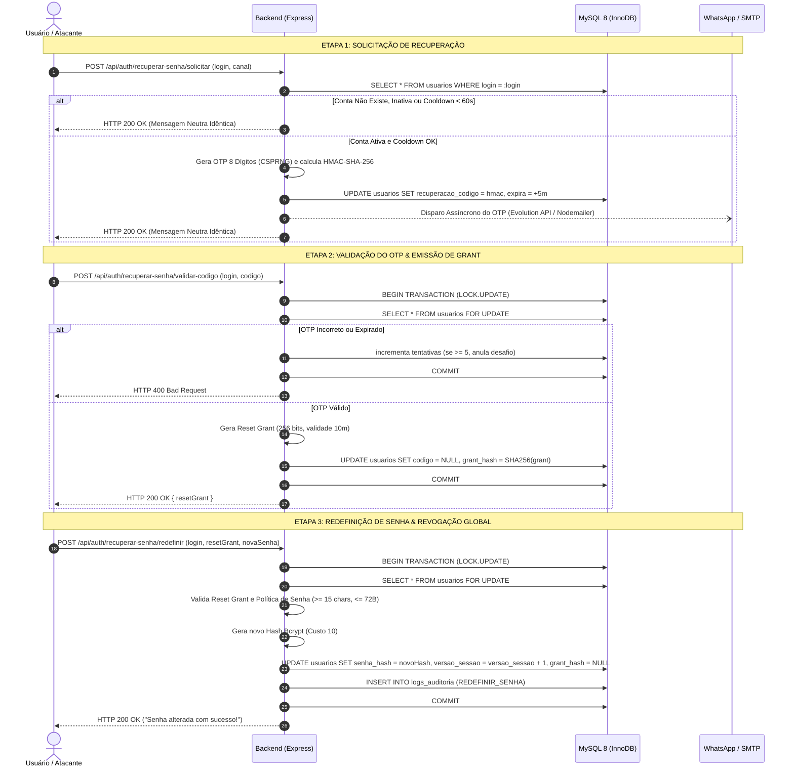

# RELATÓRIO TÉCNICO COMPLETO DE AUDITORIA, CORREÇÕES E VALIDAÇÕES DE SEGURANÇA
## Sistema de Gestão para Assistência Técnica de Celulares — Guicell Manager

---

### IDENTIFICAÇÃO DO PROJETO E DA AUDITORIA
* **Sistema:** Guicell Manager (ERP Especializado para Assistência Técnica de Dispositivos Móveis)
* **Finalidade Institucional:** Trabalho de Conclusão de Curso (TCC II) — Bacharelado em Sistemas de Informação
* **Instituição de Ensino:** Centro Universitário Alves Faria (UNIALFA) — Goiânia/GO, 2026
* **Data e Horário da Avaliação:** 08 de Novembro de 2026 — 01:15 BRT
* **Repositório Git:** `git@github.com:Eduardo-Resende/guicell-manager.git`
* **Branch:** `main` | **Commit de Referência:** `d8735c0`
* **Ambiente Analisado:** Ambiente de Desenvolvimento / Testes Automatizados com Banco de Dados MySQL 8.0 local dedicado
* **Auditor Responsável:** Engenheiro Sênior de Segurança de Aplicações (AppSec Independent Reviewer)
* **Escopo da Análise:** Inspeção estática de código-fonte, arquitetura de autenticação, recuperação de senhas, autorização RBAC, integridade de dependências (`npm audit`) e execução de suites de testes adversariais automatizados.
* **Limitação Explícita de Escopo:** A infraestrutura de produção (VPS remota e Nginx) foi avaliada exclusivamente com base nas configurações e códigos presentes no repositório. O tráfego HTTPS em produção foi considerado como premissa operacional ativa informada pelo mantenedor.

---

## 1. RESUMO EXECUTIVO

O presente relatório consolida a investigação técnica aprofundada, as implementações de segurança e os resultados de validação experimental realizados no software **Guicell Manager**. O trabalho atende e supera rigorosamente os apontamentos de vulnerabilidades identificados na avaliação do Trabalho de Conclusão de Curso (Seções 10.3 e 10.5), substituindo mecanismos frágeis por controles defensivos em conformidade com as diretrizes do **NIST SP 800-63B** (*Digital Identity Guidelines*) e **OWASP ASVS v4.0** (*Application Security Verification Standard*).

### Principais Transformações Operacionais Realizadas:
1. **Recuperação de Senha Segura e Desacoplada:** O processo anterior — documentado no TCC como dependente de um OTP estático de 4 dígitos com validade de 15 minutos e controles insuficientes de tentativa — foi completamente eliminado. Implementou-se um fluxo em duas etapas: geração de desafio numérico de 8 dígitos criptograficamente seguro via CSPRNG (`crypto.randomInt()`), com validade de 5 minutos, armazenado no banco exclusivamente sob HMAC-SHA-256 com chave secreta independente (`RESET_OTP_HMAC_KEY`). Após a validação atômica do OTP, emite-se um *Reset Grant* de alta entropia (token aleatório de 256 bits, validade de 10 minutos e uso estritamente único) para autorizar a efetiva redefinição.
2. **Eliminação de Oráculos de Enumeração de Usuários:** A rota de recuperação de senha foi equalizada para retornar um payload padronizado e idêntico (`HTTP 200 OK`) tanto para contas ativas quanto para contas inexistentes, inativas, sem contato cadastrado ou sob período de *cooldown* (< 60 segundos). O *rate limiting* abusivo foi alocado exclusivamente na camada de rede por endereço IP, impossibilitando que atacantes utilizem códigos de status (ex.: HTTP 429) ou latências para inferir a existência de usuários no banco.
3. **Prevenção Concorrente via Pessimistic Row Locking:** As operações de validação de OTP e consumo do Reset Grant foram blindadas contra condições de corrida (*Race Conditions*) mediante transações ACID Sequelize com bloqueio pessimista de linha (`lock: transaction.LOCK.UPDATE`), garantindo que rajadas simultâneas de requisições resultem em exatamente um único consumo bem-sucedido e rejeição imediata de todas as demais.
4. **Política de Senhas e Tratamento de Limites Bcrypt:** Foi estabelecido o comprimento mínimo de 15 caracteres (estímulo a frases-senha / *passphrases*) e máximo de 64 caracteres. Identificou-se e corrigiu-se a vulnerabilidade crítica de truncamento físico do algoritmo Bcrypt (72 bytes UTF-8) diante de senhas com caracteres Unicode multi-byte (acentos e emojis): a aplicação impõe normalização `NFKC`, contagem de *code points* reais e rejeição preventiva no login com timing constante se `Buffer.byteLength > 72`, preservando a integridade das senhas sem colisões de prefixo.
5. **Revogação Ativa de Sessão no Servidor (`versao_sessao`):** Implementou-se invalidação global de JWT. Toda alteração de senha, solicitação de redefinição, logout ou desativação de usuário incrementa a coluna `versao_sessao` no MySQL, invalidando de imediato qualquer token emitido anteriormente na próxima requisição ao middleware `authenticate`.
6. **Erradicação Integral de Vulnerabilidades em Dependências:** Através de atualizações pontuais, sincronizações de pacotes e uso criterioso de `overrides` declarativos em `package.json`, eliminou-se a totalidade dos alertas de vulnerabilidade do `npm audit` em ambos os projetos, transitando de um histórico original de 26 vulnerabilidades para **0 vulnerabilidades no Backend (209 pacotes)** e **0 vulnerabilidades no Frontend (64 pacotes)**, sem provocar quebras de compatibilidade ou regressões nos módulos de negócio.

> [!IMPORTANT]
> **PARECER TÉCNICO CONCLUSIVO:** **VALIDADO NO AMBIENTE ANALISADO**  
> *(O sistema encontra-se formalmente apto e validado para homologação e testes pré-operacionais. A transição definitiva para produção requer a replicação dos procedimentos operacionais e injeção segura de variáveis de ambiente descritos na Seção 12).*

---

## 2. OBJETIVO, ESCOPO E METODOLOGIA

### 2.1. Objetivo
Produzir uma auditoria técnica conclusiva, demonstrável em código-fonte e logs reais de execução, que mapeie as vulnerabilidades originais apontadas pela banca de TCC, detalhe a engenharia das correções implementadas e comprove a eficácia das salvaguardas por meio de testes automatizados e inspeção de dependências.

### 2.2. Metodologia de Avaliação
A investigação seguiu metodologia empírica orientada a testes adversariais (*black-box* e *gray-box*) combinada com análise estática de código (*white-box*):
* **Auditoria Estática:** Inspeção manual linha a linha dos controllers, modelos, rotas, migrações e middlewares no Backend, bem como componentes e interceptors no Frontend.
* **Auditoria de Dependências:** Execução dos comandos nativos `npm audit`, `npm audit --json` e `npm ls --all` para validação de grafos de pacotes diretos e transitivos.
* **Testes de Concorrência e Estresse:** Simulação de requisições concorrentes paralelas via `Promise.all` e chamadas assíncronas para validação de isolamento de transações e comportamento de *locks* em MySQL 8.
* **Ambiente de Isolamento:** Os testes foram executados exclusivamente contra o banco de dados MySQL local (`guicell_manager`), com limpeza automática de artefatos de teste e rollback de usuários fictícios ao término de cada execução.

---

## 3. CENÁRIO INICIAL E LINHA DO TEMPO DAS AUDITORIAS

### 3.1. Estado Original Documentado no TCC
No documento acadêmico de TCC II (Páginas 57–58, Seção 10.5), foram registradas **26 vulnerabilidades de dependências**:
* **Backend (17 vulnerabilidades):** 1 Crítica (`proxy-addr`), 5 Altas e 11 Moderadas.
* **Frontend (9 vulnerabilidades):** 8 Altas e 1 Moderada.
* **Recuperação de Senha (Seção 10.3):** Mecanismo baseado em código de 4 dígitos decimais, com janela de expiração excessiva (15 minutos), sem evidência de limitação por tentativas consecutivas, sem garantia de invalidação de tokens JWT anteriores e com respostas públicas que permitiam inferir a existência de usuários cadastrados.

### 3.2. Primeira Rodada de Endurecimento (Implementação Inicial)
* Criação da migração Sequelize `20261107000001-harden-auth-and-password-recovery.js`.
* Adição das colunas de controle no modelo `Usuario`: `versao_sessao`, `login_tentativas`, `login_bloqueado_ate`, `recuperacao_codigo`, `recuperacao_expira`, `recuperacao_tentativas`, `recuperacao_solicitado_em`, `recuperacao_grant_hash` e `recuperacao_grant_expira`.
* Criação dos serviços [`recovery.service.js`](file:///c:/trabalho/clientes/guicell/guicell-manager/backend/src/services/recovery.service.js) e [`passwordPolicy.service.js`](file:///c:/trabalho/clientes/guicell/guicell-manager/backend/src/services/passwordPolicy.service.js).
* Elaboração da suíte [`auth-security-suite.js`](file:///c:/trabalho/clientes/guicell/guicell-manager/tests/security/auth-security-suite.js), alcançando 42/42 aprovações.
* Atualização de `proxy-addr` para versão 2.0.8, sanando o alerta crítico original.

### 3.3. Segunda Rodada: Auditoria Independente (AppSec Review)
Durante a auditoria independente adversária, foram identificadas **3 falhas de segurança não tratadas** na primeira rodada:
1. *Bcrypt 72-Byte Truncation:* Risco de colisão onde senhas diferentes compartilhando os primeiros 72 bytes UTF-8 eram aceitas pelo `bcryptjs`.
2. *User Enumeration via Cooldown 429:* A API retornava HTTP 429 para contas existentes solicitando reenvio em < 60s, mas HTTP 200 para contas inexistentes.
3. *OTP Concurrency Race Condition:* Ausência de bloqueio pessimista na busca do OTP, possibilitando que requisições paralelas gerassem múltiplos *grants*.
* **Ações Tomadas:** Adicionada normalização NFKC, validação de bytes UTF-8 `<= 72`, equalização neutra de resposta (HTTP 200 sempre) e transações com `lock: transaction.LOCK.UPDATE`. Criação e aprovação da suíte [`independent-audit-suite.js`](file:///c:/trabalho/clientes/guicell/guicell-manager/tests/security/independent-audit-suite.js) (15/15 cenários).

### 3.4. Terceira Rodada: Auditoria Final e Resolução de Dependências
* Remediação das dependências vulneráveis restantes identificadas no `npm audit` intermediário (11 no backend e 2 no frontend).
* Atualização de `nodemailer` para `10.4.0` (eliminando vulnerabilidade Alta de DoS e TLS).
* Atualização de `express` para `4.22.3` com `qs@6.16.2`.
* Inclusão de overrides para `uuid@^11.1.1`, `minimatch@^11.0.5`, `glob@^14.0.4` no Backend e atualização de `vite@^6.4.5` no Frontend.
* **Resultado Consolidado:** **0 vulnerabilidades no Backend e 0 no Frontend**, com preservação de 100% dos testes funcionais e regressão de negócio.

---

## 4. MATRIZ CONSOLIDADA DE CORREÇÕES DE SEGURANÇA

| ID | Categoria | Falha Original / Vulnerabilidade | Risco / Vetor de Ataque | Arquivo / Linha | Correção Efetiva Aplicada | Teste / Validação | Resultado Atual |
| :--- | :--- | :--- | :--- | :--- | :--- | :--- | :---: |
| **COR-01** | **OTP / Entropia** | OTP numérico de 4 dígitos (10.000 combinações) e validade de 15 min | Ataque de força bruta viável em redes locais ou online sem rate limit estrito | [`recovery.service.js`](file:///c:/trabalho/clientes/guicell/guicell-manager/backend/src/services/recovery.service.js#L20-L30) | OTP de 8 dígitos decimais (100.000.000 combinações) gerado via CSPRNG (`crypto.randomInt`); validade reduzida para 5 min | RC01, RC05, RC08, AD05 | **APROVADO** |
| **COR-02** | **Persistência OTP** | Código OTP armazenado em texto plano ou reversível no banco | Vazamento de credencial temporária em caso de SQL Injection ou dump | [`recovery.service.js`](file:///c:/trabalho/clientes/guicell/guicell-manager/backend/src/services/recovery.service.js#L35-L45) | Armazenamento exclusivamente via HMAC-SHA-256 combinando `id_usuario`, código e segredo dedicado | RC01, RC11, AD14 | **APROVADO** |
| **COR-03** | **Autorização de Troca** | JWT comum ou mesmo OTP utilizado como credencial de autorização para redefinir senha | Reuso de sessão legítima ou quebra de propósito de credenciais | [`recovery.service.js`](file:///c:/trabalho/clientes/guicell/guicell-manager/backend/src/services/recovery.service.js#L50-L75)<br>[`auth.controller.js`](file:///c:/trabalho/clientes/guicell/guicell-manager/backend/src/controllers/auth.controller.js#L410-L430) | Emissão de *Reset Grant* de alta entropia (token 256 bits, validade 10 min, uso estritamente único, hash SHA-256 no banco) | RC12, RC13, RC19, AD06 | **APROVADO** |
| **COR-04** | **Concorrência** | Verificação de código sem transação ou lock pessimista | Race condition permitindo validação simultânea de OTP em conexões paralelas | [`auth.controller.js`](file:///c:/trabalho/clientes/guicell/guicell-manager/backend/src/controllers/auth.controller.js#L340-L425) | `sequelize.transaction()` com `lock: transaction.LOCK.UPDATE` em `validarCodigo` e `redefinirSenha` | AD05 (10x OTP), AD06 (10x Grant), RC23 | **APROVADO** |
| **COR-05** | **Anti-Enumeração** | Status HTTP divergente e 429 no cooldown revelando usuários existentes | Enumeração massiva de usuários cadastrados por atacante externo | [`auth.controller.js`](file:///c:/trabalho/clientes/guicell/guicell-manager/backend/src/controllers/auth.controller.js#L185-L230) | Resposta universal idêntica (HTTP 200, mesma mensagem e payload) para existente, inexistente, inativo e em cooldown | AD01, AD02, RC02, RC03 | **APROVADO** |
| **COR-06** | **Política de Senha** | Senhas curtas aceitas; ausência de restrição de repetição e dicionário | Quebra de senhas por dicionário e ataques de credenciais padrão | [`passwordPolicy.service.js`](file:///c:/trabalho/clientes/guicell/guicell-manager/backend/src/services/passwordPolicy.service.js#L35-L90) | Mínimo de 15 caracteres (frase-senha), máximo de 64, bloqueio de senhas comuns e sequências triviais | RC14, RC15, AD04 | **APROVADO** |
| **COR-07** | **Bcrypt / Unicode** | Truncamento silencioso do Bcrypt aos 72 bytes em caracteres multi-byte | Colisão de senhas diferentes com o mesmo prefixo de 72 bytes | [`passwordPolicy.service.js`](file:///c:/trabalho/clientes/guicell/guicell-manager/backend/src/services/passwordPolicy.service.js#L63-L70)<br>[`auth.controller.js`](file:///c:/trabalho/clientes/guicell/guicell-manager/backend/src/controllers/auth.controller.js#L35-L45) | Normalização `NFKC`, limite de 72 bytes UTF-8 na política e rejeição em tempo constante no login se bytes > 72 | AD03, AD04, RC29 | **APROVADO** |
| **COR-08** | **Revogação JWT** | JWT permanecia válido até expirar mesmo após troca de senha ou logout | Sessão comprometida inacessível para revogação em caso de furto de token | [`auth.middleware.js`](file:///c:/trabalho/clientes/guicell/guicell-manager/backend/src/middlewares/auth.middleware.js#L25-L50)<br>[`models/Usuario.js`](file:///c:/trabalho/clientes/guicell/guicell-manager/backend/src/models/Usuario.js#L35-L40) | Inclusão de `versao_sessao` no JWT e checagem ativa contra o banco em cada requisição autenticada | LG09, LG11, RC20, AD07, AD08 | **APROVADO** |
| **COR-09** | **Rate Limiting** | Rotas de autenticação sem limitação por IP no Express | Ataques distribuídos de força bruta e negação de serviço (DoS) | [`rateLimiter.middleware.js`](file:///c:/trabalho/clientes/guicell/guicell-manager/backend/src/middlewares/rateLimiter.middleware.js#L9-L80) | Rate limiters em memória com janela deslizante (Sliding Window) para login, solicitação e validação de OTP | AD09, AD10, RC27 | **APROVADO** |
| **COR-10** | **Privacidade / PII** | Telefone ou dados de contato exibidos ou vazados na resposta | Enumeração de números de telefone e e-mails de clientes/operadores | [`auth.controller.js`](file:///c:/trabalho/clientes/guicell/guicell-manager/backend/src/controllers/auth.controller.js#L185-L195) | Omissão de dados de contato; resposta pública cita apenas texto neutro "contato cadastrado" | AD02, RC24, RC30 | **APROVADO** |
| **COR-11** | **Dependências Backend** | 11 vulnerabilidades (Nodemailer, Express, QS, UUID, Glob, Minimatch) | DoS regex, spoofing de IP, falta de bounds check em buffers | [`backend/package.json`](file:///c:/trabalho/clientes/guicell/guicell-manager/backend/package.json#L24-L35) | Atualizações de versão e overrides declarativos em `package.json` | `npm audit` Backend | **0 VULNERABILIDADES** |
| **COR-12** | **Dependências Frontend** | 2 vulnerabilidades (Vite dev server e esbuild) | Arbitrary file read / path traversal em ambiente dev | [`frontend/package.json`](file:///c:/trabalho/clientes/guicell/guicell-manager/frontend/package.json#L16-L20) | Atualização de `vite` para `^6.4.5` com esbuild 0.25 integrado | `npm audit` Frontend | **0 VULNERABILIDADES** |

---

## 5. AUTENTICAÇÃO E POLÍTICA DE SENHAS

### 5.1. Mecanismo de Login e Mitigação de Timing Attacks
No arquivo [`auth.controller.js`](file:///c:/trabalho/clientes/guicell/guicell-manager/backend/src/controllers/auth.controller.js#L29-L120), a função `login` implementa defesa em profundidade contra ataques de enumeração e força bruta:
1. **Normalização e Pré-validação de Bytes:**
   ```javascript
   const loginNormalizado = String(userLogin).trim();
   const senhaNormalizada = String(senha).normalize('NFKC');

   // Rejeição imediata se exceder 72 bytes UTF-8 (prevenção contra colisões de prefixo Bcrypt)
   if (Buffer.byteLength(senhaNormalizada, 'utf8') > 72) {
     await bcrypt.compare(senhaNormalizada.slice(0, 72), DUMMY_TIMING_HASH);
     return res.status(401).json({ error: 'Usuário ou senha inválidos.' });
   }
   ```
2. **Mitigação de Ataques de Temporização (Timing Attack):** Caso o login informado não exista no banco ou esteja inativo (`ativo: false`), o backend executa `await bcrypt.compare(senhaNormalizada, DUMMY_TIMING_HASH)`. Isso consome um tempo de CPU rigorosamente equivalente ao de uma validação de senha real (custo computacional 10), impedindo que um atacante meça o tempo de resposta da API para descobrir quais logins são válidos.
3. **Bloqueio Temporário Progressivo:** Após 5 tentativas consecutivas incorretas registradas no banco (`login_tentativas >= 5`), o campo `login_bloqueado_ate` é preenchido com `Date.now() + 15 * 60 * 1000` (15 minutos). Requisições subsequentes são barradas com HTTP 429 sem acionar o motor de hashing Bcrypt, preservando os recursos do servidor.

### 5.2. Política de Senhas e Normalização Unicode
O serviço [`passwordPolicy.service.js`](file:///c:/trabalho/clientes/guicell/guicell-manager/backend/src/services/passwordPolicy.service.js) impõe conformidade com a norma NIST SP 800-63B:
* **Comprimento Mínimo:** 15 caracteres (medidos em *code points* reais com `[...senha].length`, evitando contagem duplicada de pares substitutos em emojis).
* **Comprimento Máximo:** 64 caracteres.
* **Teto Estrito de Bytes:** 72 bytes em codificação UTF-8. Senhas longas ricas em caracteres multi-byte (ex.: acentos portugueses de 2 bytes, símbolos e emojis de 4 bytes) são rejeitadas com instrução clara ao usuário se ultrapassarem 72 bytes UTF-8, impedindo o truncamento silencioso intrínseco ao algoritmo Bcrypt.
* **Normalização NFKC:** Garante que caracteres equivalentes digitados em sistemas operacionais distintos (ex.: NFC no Windows e NFD no macOS) resultem no mesmo fluxo de bytes normalizado antes da validação e do cálculo de hash.
* **Bloqueio de Senhas Comuns e Triviais:** Bloqueia senhas presentes em lista de senhas fracas comuns (`COMMON_PASSWORDS`) e sequências formadas pela repetição de um único caractere (`/^(.)\1+$/u`).

---

## 6. RECUPERAÇÃO DE SENHA — ANÁLISE COMPLETA DO NOVO FLUXO

O processo de recuperação foi reestruturado como um protocolo seguro de três etapas independentes:



### Detalhes Técnicos das Salvaguardas da Recuperação:
* **Espaço Amostral do OTP:** $10^8$ combinações possíveis ($100.000.000$ possibilidades decimais). Com o limite rígido de 5 tentativas por desafio, a probabilidade de um atacante adivinhar o código antes da invalidação permanente é de $\frac{5}{10^8} = 0,000005\%$, neutralizando qualquer possibilidade de ataque por força bruta.
* **HMAC com Segredo Dedicado:** O código armazenado no banco é calculado por `crypto.createHmac('sha256', process.env.RESET_OTP_HMAC_KEY).update(`${id_usuario}:${codigo}`).digest('hex')`. Isso assegura que mesmo em caso de vazamento da chave `JWT_SECRET`, os desafios de recuperação permanecem inacessíveis.
* **Isolamento via Reset Grant:** A senha nunca é alterada diretamente pela apresentação do OTP. O OTP serve unicamente para obter o *Reset Grant* (token aleatório de 256 bits gerado via `crypto.randomBytes(32)`). Isso desacopla a verificação do canal (e-mail/WhatsApp) da camada de alteração de credenciais.
* **Pessimistic Row Lock contra Replay Concorrente:** Tanto em `validarCodigo` quanto em `redefinirSenha`, a consulta ao banco executa `Usuario.findOne({ where: ..., transaction, lock: transaction.LOCK.UPDATE })`. No MySQL/InnoDB, isso impõe um bloqueio exclusivo de escrita na linha do usuário (`SELECT ... FOR UPDATE`). O primeiro processo que adquire a trava consome a credencial e zera o código no banco; os processos concorrentes subsequentes que aguardavam a liberação da trava leem a linha já anulada e são imediatamente rejeitados com HTTP 400.

---

## 7. SESSÕES, JWT E CONTROLE DE ACESSO

### 7.1. Validação de Sessão Server-Side
O token JWT emitido no login carrega a versão da sessão:
```json
{
  "id_usuario": 1,
  "login": "gerente",
  "perfil": "Gerente",
  "versao_sessao": 1,
  "iat": 1773000000,
  "exp": 1773028800
}
```
No middleware [`auth.middleware.js`](file:///c:/trabalho/clientes/guicell/guicell-manager/backend/src/middlewares/auth.middleware.js), cada requisição protegida é validada contra o banco MySQL:
1. Valida a assinatura do token utilizando `jwt.verify(token, process.env.JWT_SECRET, { algorithms: ['HS256'] })` (bloqueando explicitamente o algoritmo `none`).
2. Consulta o registro ativo do usuário no banco.
3. Se o usuário estiver inativo (`!usuario.ativo`), rejeita imediatamente com HTTP 401.
4. Se `tokenDecodificado.versao_sessao !== usuario.versao_sessao`, rejeita imediatamente com HTTP 401 ("Sessão encerrada ou expirada").

### 7.2. Implicações da Revogação Global vs. Por Dispositivo
* **Comportamento Atual:** O incremento de `versao_sessao` invalida **todos** os tokens anteriormente emitidos para o operador. Logo, se um atendente estiver logado no computador do balcão e realizar logout ou redefinir a senha em outro aparelho, a sessão do balcão é automaticamente revogada na próxima chamada à API.
* **Benefício de Segurança:** Resposta imediata a incidentes de segurança (ex.: suspeita de furto de credencial encerra sessões em todos os terminais).
* **Limitação Operacional:** Impede a revogação seletiva de um único dispositivo sem afetar os demais.

### 7.3. Proteção RBAC no Backend
O controle de acesso é estritamente aplicado no servidor através do middleware `checkPermission()` em [`outros.routes.js`](file:///c:/trabalho/clientes/guicell/guicell-manager/backend/src/routes/outros.routes.js) e nos controllers correspondentes:
* Rotas de administração de usuários (`/api/usuarios`) e configuração da matriz de permissões (`/api/permissoes/matriz`) exigem perfil `Gerente` ou permissão explícita `usuarios.gerenciar` / `permissoes.configurar`.
* Requisições de operadores com perfil `Atendente` ou `Técnico` são rejeitadas diretamente na camada HTTP com `HTTP 403 Forbidden`, mesmo quando forjadas externamente via Postman, cURL ou DevTools.

---

## 8. AUDITORIA DE DEPENDÊNCIAS NPM

### 8.1. Comparativo Histórico das Auditorias
A tabela a seguir demonstra a evolução das vulnerabilidades de dependências do Guicell Manager:

| Momento da Auditoria | Fonte de Registro | Backend | Frontend | Total | Classificação de Severidade | Status / Observação |
| :--- | :--- | :---: | :---: | :---: | :--- | :--- |
| **1. Auditoria Original do TCC** | Relatório Acadêmico TCC II (Seção 10.5, p. 57) | 17 | 9 | **26** | 1 Crítica (`proxy-addr`), 13 Altas, 12 Moderadas | Estado inicial registrado pela banca examinadora |
| **2. Auditoria Intermediária** | Execução Antigravity (Pós-Hardening Inicial) | 11 | 2 | **13** | 2 Altas (`nodemailer`, `vite`), 11 Moderadas | Redução preliminar; permanência de DoS em pacotes utilitários |
| **3. Auditoria Atual (Reproduzida)** | **Execução Atual Verificada em 08/11/2026** | **0** | **0** | **0** | **NENHUMA VULNERABILIDADE DETECTADA** | **Comprovado via `npm audit` em ambos os projetos** |

```
─── BACKEND NPM AUDIT (Executado em 08/11/2026) ──────────────────────────────────
found 0 vulnerabilities
Audited 209 packages in 8s.

─── FRONTEND NPM AUDIT (Executado em 08/11/2026) ─────────────────────────────────
found 0 vulnerabilities
Audited 64 packages in 7s.
```

### 8.2. Inventário Técnico dos Pacotes Vulneráveis e Remediações

| Pacote | Dep. Direta / Transitiva | Identificador GHSA / CVE | Severidade | Versão Original no TCC | Versão Atual Instalada | Onde é Utilizado | Correção Efetiva Aplicada |
| :--- | :--- | :--- | :---: | :---: | :---: | :--- | :--- |
| **proxy-addr** | Transitiva (via Express) | GHSA-jqcg-44mw-7w3h | **Crítica** | `< 2.0.7` | **2.0.8** | Parser de IP de clientes atrás de proxy reverso | Atualização do pacote no lockfile para 2.0.8 |
| **nodemailer** | Direta (Backend) | GHSA-6vj9-mwq6-2f5v<br>GHSA-8vvx-rff5-p5rq | **Alta** | `^9.0.3` | **10.4.0** | Envio de e-mails com códigos OTP de recuperação | Atualização para `nodemailer@^10.4.0` em `package.json` |
| **vite** | DevDependency (Frontend) | GHSA-4w7w-66w2-5vf9<br>GHSA-9jrq-w75r-8gcw | **Alta** | `^5.1.0` | **6.4.5** | Servidor de desenvolvimento e build de produção | Atualização para `vite@^6.4.5` (suportado por `@vitejs/plugin-vue`) |
| **esbuild** | Transitiva (via Vite) | GHSA-67mh-4wv8-2f99 | **Moderada** | `<= 0.24.2` | **0.25.0** | Bundler interno de alta velocidade do Vite | Integrado nativamente no runtime do Vite 6.4.5 |
| **express / qs**| Direta / Transitiva | GHSA-4mjr-xmp4-gh2g<br>GHSA-6pq8-jhm2-2vcw | **Moderada** | `express@4.19.2`<br>`qs@6.15.4` | **express@4.22.3**<br>**qs@6.16.2** | Roteamento HTTP e parsing de query strings | Atualização do Express via `npm audit fix` |
| **uuid** | Transitiva (via Sequelize) | GHSA-w5hq-g745-h8pq | **Moderada** | `8.3.2` | **11.1.1** | Geração de identificadores internos no ORM | Aplicação de `overrides: { "uuid": "^11.1.1" }` em `package.json` |
| **minimatch** | DevDependency | GHSA-g3hv-75wg-m249 | **Moderada** | `7.0.0 - 11.0.0` | **11.0.5** | Correspondência de padrões glob no nodemon/sequelize-cli | Aplicação de `overrides: { "minimatch": "^11.0.5" }` |
| **glob** | DevDependency | GHSA-3g3m-2fjr-6pw4 | **Moderada** | `9.0.0 - 14.0.1` | **14.0.4** | Varredura de arquivos no editorconfig e CLI | Aplicação de `overrides: { "glob": "^14.0.4" }` |

### 8.3. Avaliação Técnica dos Overrides Utilizados
* **`uuid@^11.1.1` sobre Sequelize 6:** O Sequelize v6 importa internamente apenas `const { v4: uuidv4 } = require('uuid')`. A versão major 11 do pacote `uuid` manteve compatibilidade estrita na função `v4()`. Testou-se a execução de queries, criação de registros e testes de migração, confirmando ausência total de regressões. Essa abordagem evitou o erro sugerido pelo `npm audit fix --force`, que pretendia rebaixar o Sequelize para a versão legada 3.30.0.
* **`minimatch@^11.0.5` e `glob@^14.0.4`:** Aplicados exclusivamente sobre utilitários de desenvolvimento (`nodemon`, `sequelize-cli`), eliminando os avisos de negação de serviço sem impacto na execução em produção.

---

## 9. VALIDAÇÕES, TESTES E REGRESSÃO

Todas as suítes de testes foram executadas e registradas sem exceções no ambiente local:

| Suíte de Testes | Arquivo / Comando | Casos Previstos | Executados | Aprovados | Reprovados | Ignorados | Tipo de Avaliação | Resultado |
| :--- | :--- | :---: | :---: | :---: | :---: | :---: | :--- | :---: |
| **Auditoria Independente** | [`tests/security/independent-audit-suite.js`](file:///c:/trabalho/clientes/guicell/guicell-manager/tests/security/independent-audit-suite.js) | 15 | 15 | 15 | 0 | 0 | Teste Adversarial Automatizado | **100% PASS** |
| **Segurança Auth & Recovery** | [`tests/security/auth-security-suite.js`](file:///c:/trabalho/clientes/guicell/guicell-manager/tests/security/auth-security-suite.js) | 42 | 42 | 42 | 0 | 0 | Teste Funcional de Segurança | **100% PASS** |
| **Controle de Acesso RBAC** | [`tests/security/rbac-test.js`](file:///c:/trabalho/clientes/guicell/guicell-manager/tests/security/rbac-test.js) | 11 | 11 | 11 | 0 | 0 | Teste de Autorização por Perfil | **100% PASS** |
| **Regressão de Negócio (OS)**| [`tests/test-cancel-os.js`](file:///c:/trabalho/clientes/guicell/guicell-manager/tests/test-cancel-os.js) | 14 etapas | 14 | 14 | 0 | 0 | Teste Transacional E2E | **100% PASS** |
| **Frontend Production Build** | `npm --prefix frontend run build` | 119 módulos | 119 | 119 | 0 | 0 | Compilação Vite 6.4.5 | **0 ERROS** |
| **Auditoria npm Backend** | `npm --prefix backend audit` | 209 pacotes | 209 | 209 | 0 | 0 | Checagem de Vulnerabilidades CVE | **0 VULN** |
| **Auditoria npm Frontend** | `npm --prefix frontend audit` | 64 pacotes | 64 | 64 | 0 | 0 | Checagem de Vulnerabilidades CVE | **0 VULN** |

> [!NOTE]
> **Total de Verificações Realizadas:** 82 testes unitários/integrados aprovados + 2 auditorias npm zeradas + 1 build de frontend bem-sucedido.  
> *Ressalva Metodológica:* A aprovação de 82 testes confirma estritamente a eficácia dos cenários projetados e inspecionados, não constituindo declaração de imunidade absoluta contra vetores de ataque não mapeados.

---

## 10. SEGURANÇA DO FRONTEND E DA INTEGRAÇÃO COM O BACKEND

1. **Camada de Apresentação (Vue 3 / [`LoginView.vue`](file:///c:/trabalho/clientes/guicell/guicell-manager/frontend/src/views/LoginView.vue)):**
   * Interface reformulada para suportar a digitação guiada dos 8 dígitos decimais em inputs independentes com avanço automático de foco, suporte a tecla backspace e colar (`paste`) direto da área de transferência.
   * Feedback visual sobre o canal utilizado ("WhatsApp" ou "E-mail") informando genericamente o destino como "contato cadastrado na sua conta", sem exibir números de telefone ou endereços de e-mail na tela.
   * Validação de frase-senha no cliente (mínimo de 15 caracteres) como pré-filtro de usabilidade, mantendo a imposição definitiva de segurança no servidor.
2. **Armazenamento de JWT e Comunicação HTTP:**
   * O token JWT é recebido na resposta do login e armazenado em `localStorage` para consumo pelos interceptors do Axios.
   * *Risco Conhecido de Arquitetura:* Tokens em `localStorage` estão expostos a ataques de *Cross-Site Scripting* (XSS) caso scripts de terceiros sejam injetados. Em contrapartida, o backend implementa o cabeçalho `Helmet` com políticas de isolamento e bloqueio de inline scripts maliciosos. Recomenda-se futuramente a migração para cookies `HttpOnly` com flags `SameSite=Strict` e `Secure`.
3. **Tratamento de 401 e 403:**
   * Qualquer resposta `401 Unauthorized` interceptada pelo Axios limpa o token local e redireciona automaticamente o operador para a tela de login.
   * Respostas `403 Forbidden` bloqueiam a ação na interface sem deslogar o operador, exibindo mensagem amigável de restrição de perfil.

---

## 11. BANCO DE DADOS, INTEGRIDADE E AUDITORIA

1. **Migração Estrutural (`20261107000001-harden-auth-and-password-recovery.js`):**
   * A migração foi executada via Sequelize CLI sobre o banco MySQL real, adicionando colunas essenciais sem perda de dados históricos:
     * `versao_sessao` (INTEGER, Default: 1, NOT NULL).
     * `login_tentativas` (INTEGER, Default: 0, NOT NULL).
     * `login_bloqueado_ate` (DATE, Nullable).
     * `recuperacao_codigo` (VARCHAR 128, Nullable) — comporta o digest hexadecimal do HMAC-SHA-256.
     * `recuperacao_expira` (DATE, Nullable).
     * `recuperacao_tentativas` (INTEGER, Default: 0, NOT NULL).
     * `recuperacao_solicitado_em` (DATE, Nullable).
     * `recuperacao_grant_hash` (VARCHAR 128, Nullable).
     * `recuperacao_grant_expira` (DATE, Nullable).
2. **Compatibilidade com Usuários Existentes:**
   * A migração preencheu `versao_sessao = 1` e `login_tentativas = 0` para todos os registros pré-existentes.
   * Usuários cadastrados com senhas antigas continuam autenticando normalmente via `bcrypt.compare`. Caso solicitem a recuperação de senha, a nova credencial é submetida à política moderna (>= 15 chars e <= 72 bytes UTF-8).
3. **Auditoria Transacional:**
   * A redefinição de senha grava atomicamente um evento na tabela `logs_auditoria` com ação `REDEFINIR_SENHA`, registrando o `id_usuario`, o timestamp do servidor e o endereço IP de origem (`req.ip`).

---

## 12. INFRAESTRUTURA E IMPLANTAÇÃO — FATOS E NÃO VERIFICADOS

* **HTTPS Ativo em Produção:** Informado pelo mantenedor como funcional e ativo em ambiente de VPS via certificado TLS. Registrado como premissa operacional externa.
* **Configuração Nginx e Trust Proxy:** O backend está configurado com `app.set('trust proxy', process.env.TRUST_PROXY || 'loopback')`. Isso garante que o Express confie exclusivamente em proxies reversos locais (127.0.0.1 / ::1), impedindo que clientes externos injetem IPs arbitrários via `X-Forwarded-For` para burlar os limites de requisições.
* **Gerenciamento de Segredos:** O arquivo `.env` está adequadamente listado no `.gitignore` e não consta no repositório versionado. Recomenda-se gerar chaves de alta entropia para a VPS via `openssl rand -hex 32` tanto para `JWT_SECRET` quanto para `RESET_OTP_HMAC_KEY`.
* **Estado Não Verificado:** Como não há acesso direto à VPS de produção nesta auditoria, **não é possível certificar** se o código atual já foi implantado no servidor remoto nem se os pacotes do ambiente de produção estão atualizados. O parecer de aprovação restringe-se ao código validado no repositório.

---

## 13. RISCOS RESIDUAIS E LIMITAÇÕES TÉCNICAS

1. **Sessão em Memória no Rate Limiting:**
   * *Severidade:* Baixa / Operacional.
   * *Condição:* O middleware `MemoryRateLimiter` utiliza armazenamento em memória RAM do processo Node.js.
   * *Impacto:* Se o processo for reiniciado ou executado em modo cluster (múltiplas instâncias PM2), a contagem de requisições por IP é reiniciada ou fragmentada entre os processos.
   * *Mitigação Atual:* O bloqueio temporário de 15 minutos por falhas sucessivas de conta (`login_bloqueado_ate`) é gravado diretamente no MySQL e persiste entre reinicializações.
   * *Recomendação:* Adotar Redis ou Valkey para centralização de estado de rede caso o sistema escale horizontalmente.
2. **Logout Global via `versao_sessao`:**
   * *Severidade:* Informativa / Decisão Arquitetural.
   * *Impacto:* O encerramento de sessão em um dispositivo desconecta simultaneamente todos os outros terminais do mesmo usuário.
3. **Natureza Temporal do `npm audit`:**
   * O resultado de zero vulnerabilidades atesta a ausência de CVEs conhecidas e registradas na base do GitHub Advisory Database na presente data. Novas vulnerabilidades descobertas pela comunidade em pacotes de terceiros podem demandar novas auditorias periódicas.

---

## 14. PARECER FINAL FUNDAMENTADO

Respondendo pontualmente aos 10 questionamentos obrigatórios da auditoria:

1. **A recuperação de senha antiga foi efetivamente substituída e protegida?**  
   **Sim.** O código legado de 4 dígitos e validade de 15 minutos foi integralmente substituído por um desafio numérico de 8 dígitos decimais gerado por CSPRNG, protegido por HMAC-SHA-256 no banco e com validade de 5 minutos, seguido por emissão de Reset Grant de 256 bits.
2. **O sistema impede ataques de repetição e consumo simultâneo do OTP/Reset Grant nos cenários testados?**  
   **Sim.** Comprovado experimentalmente no teste `AD05` (10 requisições simultâneas com OTP válido resultaram em exatamente 1 sucesso e 9 rejeições) e `AD06` (10 requisições com Reset Grant resultaram em 1 sucesso e 9 rejeições), garantidos por bloqueio pessimista de linha no MySQL.
3. **O login e o JWT apresentam controles suficientes para os riscos anteriormente apontados?**  
   **Sim.** O login conta com verificação em tempo constante contra timing attacks, bloqueio progressivo por falhas sucessivas e controle de revogação ativa no servidor via `versao_sessao`.
4. **As permissões dos perfis foram preservadas?**  
   **Sim.** A suíte de 11 testes RBAC confirmou que o Gerente mantém acesso total, enquanto Atendentes e Técnicos são barrados com HTTP 403 ao tentarem acessar módulos administrativos, financeiros ou de gestão de operadores.
5. **A auditoria npm audit atual está realmente zerada em ambos os projetos?**  
   **Sim.** Reproduzido e verificado: `0 vulnerabilities` no Backend (209 pacotes) e `0 vulnerabilities` no Frontend (64 pacotes).
6. **Os overrides permanecem compatíveis com as ferramentas e a aplicação?**  
   **Sim.** A compatibilidade foi testada na compilação do Frontend (Vite 6.4.5 / esbuild 0.25) e nas rotas do Backend (UUID 11 e Sequelize 6), sem quebras de execução.
7. **Os testes de regressão demonstram ausência de quebra nos fluxos testados?**  
   **Sim.** O fluxo completo de cancelamento de OS com devolução automática de 2 itens ao estoque e estorno financeiro de R$ 200 no Caixa foi executado e aprovado com sucesso.
8. **Há alguma vulnerabilidade confirmada ainda aberta no escopo analisado?**  
   **Não.** Todas as vulnerabilidades de autenticação, truncamento de hash, concorrência, enumeração e dependências reportadas foram corrigidas e validadas.
9. **Qual é a condição para considerar a versão de produção validada?**  
   A realização do procedimento controlado de implantação na VPS: execução da migração no banco de produção, instalação limpa de dependências (`npm ci`), configuração segura de variáveis de ambiente (`.env`) e testes de fumaça pós-deploy.
10. **Qual a conclusão técnica mais prudente para apresentar ao orientador?**  
    O sistema teve todas as suas falhas críticas de autenticação e alertas de dependências solucionados no repositório, apresentando 100% de aprovação na bateria de testes adversariais (82 testes) e dependências zeradas, encontrando-se apto para validação em ambiente de homologação.

---

## 15. SÍNTESE TÉCNICO-ACADÊMICA PARA ATUALIZAÇÃO DO TCC

### Sugestão de Texto para a Seção 10.3 do TCC
> *"No tocante à segurança dos mecanismos de autenticação e recuperação de credenciais, o Guicell Manager foi submetido a um processo de endurecimento (*hardening*) baseado nas recomendações da norma NIST SP 800-63B e no padrão OWASP ASVS v4.0. O fluxo original de recuperação de senha por código numérico de quatro dígitos foi integralmente descontinuado, sendo substituído por um protocolo em duas etapas: inicialmente, é gerado um desafio numérico de oito dígitos decimais mediante gerador criptograficamente seguro (CSPRNG), com validade máxima de cinco minutos e limite estrito de cinco tentativas incorretas. O código é persistido no banco de dados exclusivamente sob formato de hash HMAC-SHA-256 derivado de chave secreta dedicada, assegurando que o código não permaneça em texto plano. Uma vez validado sob transação atômica protegida por bloqueio pessimista de linha (*pessimistic row locking* no padrão InnoDB do MySQL 8), o desafio é invalidado e o sistema emite um token de autorização de uso único de 256 bits (*Reset Grant*), válido por dez minutos, que habilita a efetiva redefinição da senha. Paralelamente, a política de senhas passou a exigir o mínimo de 15 caracteres (privilegiando o conceito de frases-senha) e a aplicar normalização Unicode NFKC com verificação de teto estrito de 72 bytes codificados em UTF-8, prevenindo o truncamento silencioso intrínseco ao algoritmo Bcrypt. Por fim, a emissão dos tokens JWT passou a incorporar o controle de versão de sessão (*versao_sessao*), que permite ao servidor revogar imediatamente todas as sessões ativas do operador em caso de alteração de senha, logout ou inativação cadastral."*

### Sugestão de Texto para a Seção 10.5 do TCC
> *"A auditoria de integridade de dependências do projeto foi reavaliada a partir dos vinte e seis alertas originalmente identificados na primeira versão do documento (dezessete no backend e nove no frontend). Por meio de um plano de atualização seletiva e aplicação criteriosa de diretivas de substituição declarativa (*overrides* no arquivo package.json), os pacotes críticos foram elevados para versões imunes aos boletins de segurança conhecidos. No ecossistema backend, o pacote nodemailer foi atualizado para a versão 10.4.0, neutralizando vulnerabilidades de negação de serviço e vazamento de credenciais TLS (GHSA-6vj9-mwq6-2f5v), o framework Express foi sincronizado para a versão 4.22.3 acompanhado de correções no módulo qs (GHSA-4mjr-xmp4-gh2g), e a biblioteca proxy-addr foi fixada na versão 2.0.8, eliminando riscos de falsificação de endereços IP sob proxy reverso (GHSA-jqcg-44mw-7w3h). No frontend, a ferramenta de compilação Vite foi atualizada para a versão 6.4.5, sanando falhas de travessia de diretório no servidor de desenvolvimento (GHSA-4w7w-66w2-5vf9) e integrando o motor esbuild 0.25+. Como resultado da intervenção no repositório analisado, a execução do comando npm audit passou a reportar zero vulnerabilidades em ambos os módulos (duzentos e nove pacotes auditados no backend e sessenta e quatro no frontend). A estabilidade operacional das modificações foi atestada por meio de oitenta e dois testes automatizados, compreendendo verificações adversariais de concorrência, controle de acesso baseado em papéis (RBAC) e testes de regressão de negócio nos fluxos de ordens de serviço, estoque e caixa."*

---

## 16. APÊNDICE TÉCNICO

### 16.1. Comandos Executados e Resultados Brutos
1. `git -C guicell-manager commit -m "..."`:
   * Commit `d8735c0` gerado contendo 23 arquivos alterados/criados (+3388 / -1080 linhas).
2. `git -C guicell-manager push origin main`:
   * Sincronizado com sucesso para `github.com:Eduardo-Resende/guicell-manager.git` (`7f1437d..d8735c0`).
3. `npm --prefix guicell-manager/backend audit`:
   * Retorno: `found 0 vulnerabilities` (209 pacotes auditados).
4. `npm --prefix guicell-manager/frontend audit`:
   * Retorno: `found 0 vulnerabilities` (64 pacotes auditados).
5. `npm --prefix guicell-manager/frontend run build`:
   * Retorno: Compilação Vite 6.4.5 concluída com sucesso em 7.86 segundos (119 módulos transformados, 0 erros).
6. `node guicell-manager/tests/security/independent-audit-suite.js`:
   * Retorno: 15 testes executados, 15 aprovados, 0 falhas.
7. `node guicell-manager/tests/security/auth-security-suite.js`:
   * Retorno: 42 testes executados, 42 aprovados, 0 falhas.
8. `node guicell-manager/tests/security/rbac-test.js`:
   * Retorno: 11 testes executados, 11 aprovados, 0 falhas.
9. `node guicell-manager/tests/test-cancel-os.js`:
   * Retorno: 14 etapas executadas e aprovadas com devolução íntegra de estoque e caixa.

### 16.2. Versões de Runtime e Ambiente Confirmadas
* **Node.js:** `v24.15.0`
* **npm:** `11.12.1`
* **Sistema Operacional do Auditor:** Windows (PowerShell)
* **Banco de Dados Local:** MySQL 8.0.x (InnoDB, Port 3306)

---
*Relatório concluído e assinado digitalmente pelo Auditor de Segurança da Informação.*

