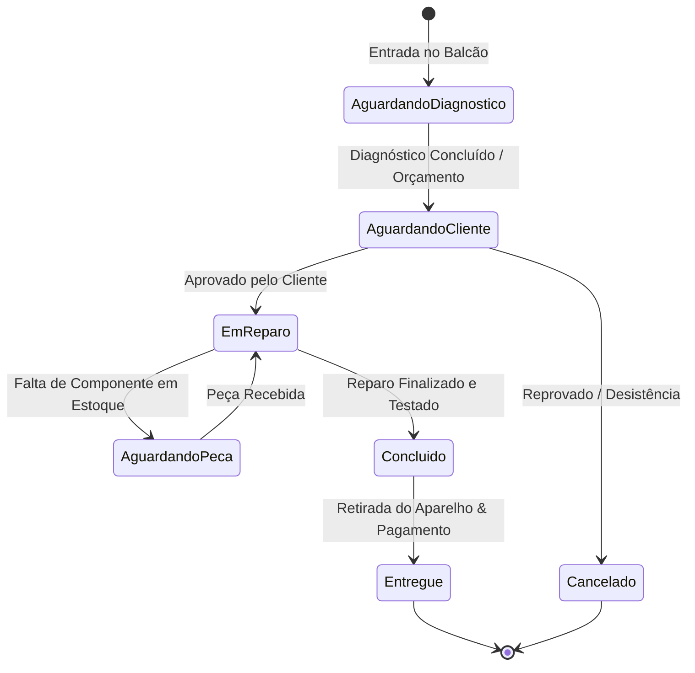

# Documentação Técnica e Operacional: Módulo Ordens de Serviço (`OsView.vue` & `OsViewer.vue`)

> **Documento de Arquitetura, Regras de Negócio e Manual Operacional**  
> **Status:** Atualizado com quadro Kanban, consumo atômico de estoque, bloqueio com caixa fechado, emissão de comprovante em PDF e envio automático via WhatsApp (Evolution API).

---

## 1. Visão Geral e Propósito

O módulo de **Ordens de Serviço (OS)** é o coração operacional da assistência técnica da **Guicell**. Ele gerencia todo o ciclo de vida da manutenção dos smartphones, desde a entrada no balcão até a entrega final ao cliente.

Seus principais objetivos são:
- Padronizar o atendimento técnico e registrar o histórico completo de cada aparelho atendido.
- Disponibilizar duas visualizações integradas: **Tabela Analítica** e **Quadro Kanban Visual**.
- Rastrear diagnósticos, defeitos relatados, prazos prometidos e técnicos designados.
- Controlar o consumo de componentes e peças de reposição com baixa imediata no estoque.
- Fechar o atendimento com cálculo dinâmico (mão de obra + peças aplicadas), com suporte a pagamentos à vista, pagamentos divididos entre várias formas/contas e controle de fiado.
- Exigir caixa da loja aberto para entrega e recebimento financeiro de ordens de serviço.
- Gerar comprovantes impressos em PDF de padrão profissional e permitir o envio imediato da OS em PDF diretamente para o WhatsApp do cliente.

---

## 2. Ciclo de Vida e Status da Ordem de Serviço

O fluxo da OS transita pelas seguintes etapas:

| Status | Badge / Cor | Descrição Operacional |
| :--- | :--- | :--- |
| **Aguardando Diagnóstico** | Amarelo | Aparelho recebido no balcão aguardando avaliação da bancada técnica. |
| **Aguardando Cliente** | Roxo | Orçamento e laudo prontos, aguardando aprovação de preço pelo cliente. |
| **Aguardando Peça** | Vermelho | Manutenção pausada aguardando entrega de componente pelo fornecedor. |
| **Em Reparo** | Azul | Aparelho aprovado em processo ativo de manutenção na bancada. |
| **Concluído** | Verde Claro | Serviço finalizado e revisado, pronto para retirada pelo cliente. |
| **Entregue** | Verde Escuro | Aparelho retirado pelo cliente com quitação ou lançamento a prazo. |
| **Cancelado** | Cinza | Atendimento abortado; estorna eventuais peças reservadas no estoque. |

---

## 3. Interface do Usuário

A tela principal [`OsView.vue`](file:///c:/trabalho/clientes/guicell/guicell-manager/frontend/src/views/OsView.vue) oferece:

### 3.1. Alternância entre Visão Tabela e Kanban
- **Tabela:** Listagem paginada e ordenável, com busca global (número da OS, nome do cliente, telefone, aparelho, IMEI) e filtro rápido por status.
- **Kanban:** Colunas dinâmicas arrastáveis/visuais correspondentes a cada status da OS, permitindo acompanhar visualmente a carga de trabalho de cada técnico.

### 3.2. Modal de Nova Ordem de Serviço
- Seleção reativa de Cliente cadastrado (com busca preditiva por nome ou CPF).
- Seleção de Aparelho do cliente (ou atalho para cadastrar novo aparelho na hora).
- Seleção de Técnico responsável.
- Registro detalhado do defeito relatado e acessórios deixados (carregador, capa, chip).
- Definição do prazo estimado de entrega com validação de data futura.

### 3.3. Modal de Gestão Técnica & Consumo de Peças
- Registro do diagnóstico técnico conclusivo.
- Tabela de **Peças e Componentes Utilizados**:
  - Permite ao técnico selecionar itens do estoque (apenas categorias com `tipo_uso` *OS* ou *Ambos*).
  - Informar a quantidade consumida.
  - O sistema calcula o subtotal das peças e soma à mão de obra para sugerir o valor orçado.
- Ao salvar a OS, o sistema executa a função transacional `atualizarItensEstoque`:
  - As peças adicionadas são debitadas do estoque em `produtos`.
  - Se uma peça for removida da OS, a quantidade correspondente é devolvida ao estoque automaticamente.

### 3.4. Modal de Fechamento e Entrega de OS
- Exibe o resumo de custos: Mão de Obra + Peças Utilizadas - Descontos = **Valor Final**.
- **Trava de Caixa Fechado:** Se o caixa da loja estiver fechado, a entrega é bloqueada com aviso visual.
- **Opções de Pagamento:**
  - *À vista / Forma única:* Dinheiro, PIX, Cartão de Débito, Cartão de Crédito.
  - *Pagamentos Divididos:* Permite combinar múltiplas formas (ex: R$ 100 no PIX + R$ 50 em Dinheiro).
  - *Fiado (A prazo):* Registra a OS como entregue com status de pagamento `pendente`, abastecendo a carteira de fiado para recebimento posterior.
- Gera automaticamente o lançamento de receita correspondente na tabela `caixa` e nas pernas de `caixa_pagamentos`.

---

## 4. Visualizador de Documento e Impressão (`OsViewer.vue`)

O componente [`OsViewer.vue`](file:///c:/trabalho/clientes/guicell/guicell-manager/frontend/src/components/OsViewer.vue) fornece a via formal da Ordem de Serviço para entrega ao cliente ou arquivamento:

1. **Cabeçalho:** Identificação da assistência técnica Guicell, endereço, telefone e número oficial da OS (`#001`).
2. **Dados do Cliente e Aparelho:** Nome, telefone, marca, modelo, IMEI e data de entrada.
3. **Laudo e Defeito:** Discriminação do defeito relatado e do diagnóstico realizado.
4. **Peças e Serviços Utilizados:** Relação dos componentes e serviços executados com suas respectivas quantidades (ocultando os preços individuais de custo de cada peça para preservar as margens comerciais da loja).
5. **Totais e Assinaturas:** Exibição clara do **Total Final** e linhas para assinatura do técnico e do cliente.
6. **Exportação & WhatsApp:**
   - **Imprimir:** Abertura da janela nativa de impressão com renderização em folha A4.
   - **Baixar PDF:** Geração de arquivo `OS-XXX.pdf` via `html2canvas` e `jsPDF`.
   - **Enviar por WhatsApp:** Dispara o PDF gerado diretamente para o número do cliente via endpoint `/api/ordens-servico/enviar-whatsapp`, integrando com a Evolution API.

---

## 5. Arquitetura do Backend e Regras de Integridade

- **Modelos:** `Movimentacao` (`origem = 'os'`), `ItemMovimentacao`, `Aparelho`, `Cliente`, `Usuario`, `Caixa`, `LogAuditoria`.
- **Transações ACID:** A gravação da OS, a atualização de itens de estoque e os lançamentos no caixa ocorrem sob a mesma transação gerenciada (`sequelize.transaction`). Se houver falha de rede ou divergência de valor, todo o processo sofre rollback.
- **Auditoria RNF09:** Ao cancelar uma OS (`CANCELAR`) ou ao entregá-la (`FECHAR`), é gravado um registro na tabela `logs_auditoria` com os dados antes e depois da operação.

---

## 6. Matriz de Permissões (RBAC) de Ordens de Serviço

| Permissão | Finalidade | Gerente | Atendente | Técnico |
| :--- | :--- | :---: | :---: | :---: |
| `os.ver` | Visualizar listagem de OS, Kanban e detalhes do aparelho. | Sim | Sim | Sim |
| `os.criar` | Abrir novas ordens de serviço e cadastrar aparelhos. | Sim | Sim | Sim |
| `os.editar` | Alterar diagnóstico, adicionar/remover peças e prazos. | Sim | Não | Sim |
| `os.status` | Mover OS entre etapas operacionais no Kanban ou tabela. | Sim | Não | Sim |
| `os.excluir` | Cancelar ordens de serviço (com justificativa em auditoria). | Sim | Não | Não |
| `os.imprimir` | Gerar comprovante impresso, exportar PDF e enviar via WhatsApp. | Sim | Sim | Sim |

